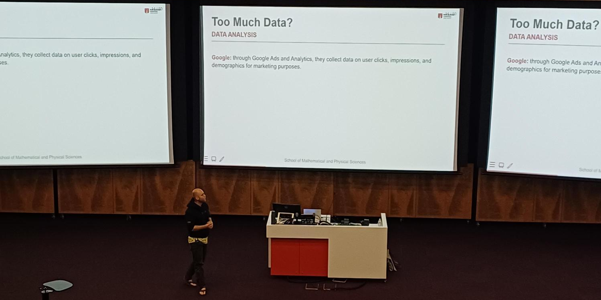
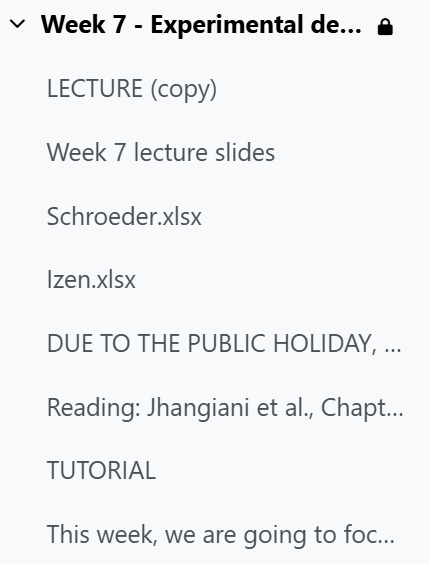
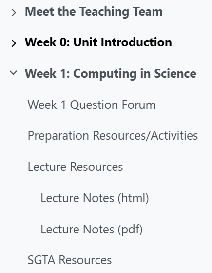

##

::: {.r-fit-text}
COME AS YOU ARE
:::

### First Year On Your Terms

Dr Connor Smith

##

{fig-align="center" fig-alt="Olga Kozar 10 January, 2023 TECHE post."}

## {background-color="#A6192E"}

::: {.r-fit-text}
First year is where students\
quietly decide\
whether they belong.
:::

## {background-color="#FFFFFF"}

::: {.r-fit-text}
[1 in 7]{style="color: #D6001C;"}
:::

Australians aged 15–24 live with disability

::: {style="font-size: 0.45em; margin-top: 1.5em;"}
Australian Bureau of Statistics (2024). *Disability, Ageing and Carers, Australia: Summary of findings, 2022*
:::

## {background-color="#373A36"}

::: {.r-fit-text}
Week 0: "Tell me about you."
:::

 

*My FOSE/FOSX1025*: an anonymous welcome survey

 

Experience · Hopes · Worries · Work & care

##

### The barriers aren't the content

::: {.r-fit-text}
They're the friction around it.
:::

## {background-color="#EDEBE5"}

### Aim

::: {.r-fit-text}
Stay. Seek help. Persist.
:::

## {background-color="#373A36"}

::: {.r-fit-text}
① One teaching voice
:::

{fig-align="center" fig-alt="Connor Smith delivering a STAT1250 lecture."}

## Lessons from Middle-earth

1. "Keep it `secret.R`, keep it `safe.R`"

2. "That still only counts as `n <- 1`

3. The Valar didn't upgrade Gandalf, they just called `levels(gandalf)[1] <- 'White'`.

##

::: {.r-fit-text}
Less decoding.\
More learning.
:::

Lower cognitive load from fewer disconnected sources

## {background-color="#373A36"}

::: {.r-fit-text}
② Nobody learns alone
:::

## {background-image="images/qa.png" background-size="cover" background-opacity="0.35"}

::: {.r-fit-text}
Asking is part\
of the unit.
:::

Help-seeking built in, not bolted on

## {background-color="#373A36"}

::: {.r-fit-text}
③ Predictable structure
:::

::: {layout-ncol=2}
{style="height: 400px !important; width: auto !important;" fig-alt="STAT1103 iLearn Page S2 2023"}

{style="height: 400px !important; width: auto !important;" fig-alt="FOSE1025 iLearn Page S1 2026"}
:::

## {background-color="#A6192E"}

::: {.r-fit-text}
Easier to navigate.\
Easier to ask.
:::

## {background-color="#373A36"}

::: {.r-fit-text}
"I also appreciated your asking and\
implementing feedback from students,\
even though we are only first years."
:::